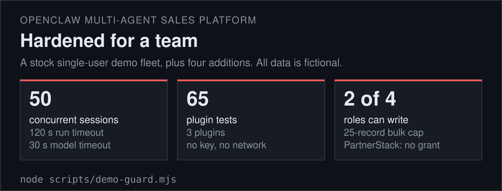
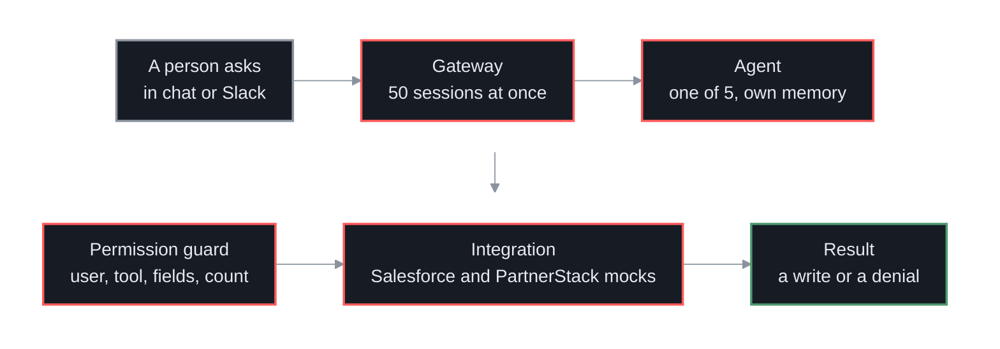
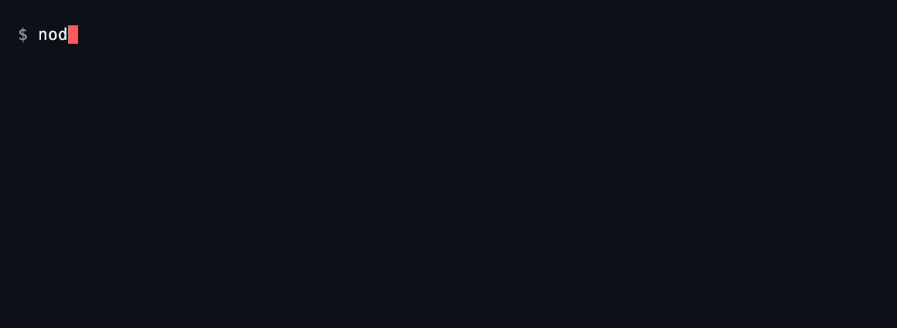
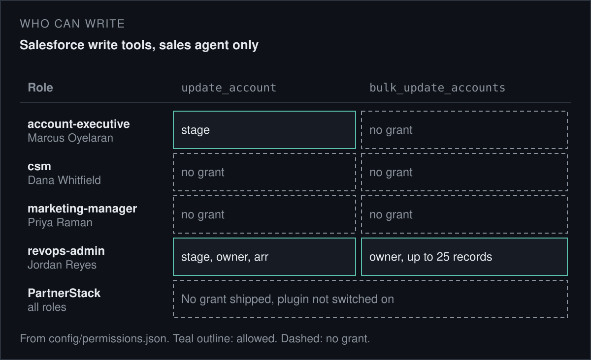
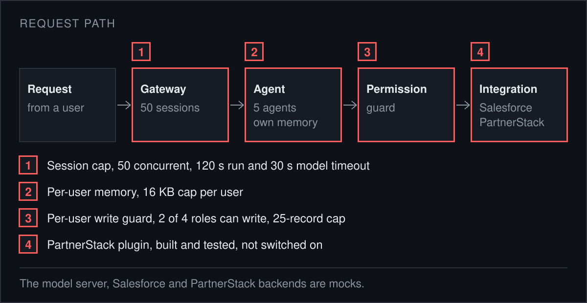

<p align="center">
<a href="https://github.com/jameswniu/openclaw-multi-agent-sales-platform/actions/workflows/gates.yml"></a>


</p>

<p align="center"><code>request -> gateway -> agent -> permission guard -> integration</code></p>

This repo is a fleet of 5 agents on the [OpenClaw](https://github.com/openclaw/openclaw) gateway. An agent is a chat assistant with one job, here router, marketing, sales, ads and auditor. The gateway is the server that runs them and takes chat from the web, Slack and the command line. It began as a stock single-user demo fleet and was hardened for a team with four additions.

The one idea is that a write is checked in code, outside the model. A permission guard looks up who is asking, which agent, which tool and which fields. A grant, which is one written permission in `config/permissions.json`, must match. Without a grant the model never sees the tool, so no prompt can talk its way past it.

Every number on this page is read from this repo's files by `tools/facts.py` and compared with this text on each push. The model server and both backends are mocks, which means canned stand-ins. Nothing here calls a real model or a real customer system. The company, Northwind, and its people are invented, on `.example` addresses.





## What the four additions do



- **Session cap:** The gateway is set to 50 concurrent sessions, with a 120-second run timeout and a 30-second model timeout. These are settings in `openclaw.json`, not measured speed.
- **Per-user memory:** Each user's notes are kept apart from every other user's, with a 16 KB cap per user.
- **Permission guard:** 2 of 4 roles hold a write grant. An account executive can change a deal stage. A revenue operations admin can also change owner and annual revenue, and bulk update up to a 25-record cap.
- **PartnerStack plugin:** It talks to a partner-payments service. A repeated request does not repeat a payment, every write lands in a ledger, and a person must approve it. It is built and tested, not switched on in the shipped config.

> 65 plugin tests pass, 14 in Salesforce, 34 in PartnerStack and 17 in user-memory. They need no key and no network.



## What this page cannot show you

- **Model quality:** The model is a mock that gives canned replies, so nothing here says how well a real model would do the jobs.
- **Speed:** The cap of 50 is a setting. `scripts/load-test.mjs` can measure it, and no result from it is claimed here.
- **PartnerStack:** The plugin has never run against the live service. Setting `backend: "http"` would reach it, and writes there move real money.
- **Gateway login:** The gateway runs with `auth none`, bound to loopback only. That is for a local demo and must not be exposed on a network.
- **Versions:** Tested with openclaw 2026.6.35 on Node 22 and 26. Later releases need a newer Node and were not tested.
- **Sample:** There are 4 users, 4 roles and a short account list. It shows the shape of the design, not behavior under real load.
- **Known limits:** Five known weaknesses are written down in `docs/known-limits.md`.

## Quick start

```bash
git clone https://github.com/jameswniu/openclaw-multi-agent-sales-platform
cd openclaw-multi-agent-sales-platform
node scripts/demo-guard.mjs
mkdir -p .reports
for p in salesforce partnerstack user-memory; do
  (cd plugins/$p && npm ci --no-audit --no-fund \
    && npx vitest run --reporter=default --reporter=json --outputFile.json=../../.reports/$p.json)
done
python3 tools/check_readme.py
```

> Node 22 or newer, tested on 22 and 26, and Python 3. No key. The installs take a few minutes. Everything written is git-ignored.

The first command needs no install. It loads the real config and prints six write attempts. Starting the mock model and the gateway is in [`docs/run.md`](docs/run.md).

## Use it with your own agents

Put your people in `config/users.json` and map each chat sender to one of them in `config/permissions.json`. Then add a grant for each role, agent and tool that may write. A tool with no grant is never offered. The steps are in [`docs/run.md`](docs/run.md), and the problems this design answers are in [`docs/design-goals.md`](docs/design-goals.md).

## What ships and what stays private

- **Ships:** The agents, the config, the plugins, the mock servers, the scripts and the figure generators.
- **Stays out:** No real keys, customers or accounts are in the repo. Everything in it is made up.
- **License:** The Apache 2.0 license covers the added work listed in `NOTICE`. The agent workspaces, the mock model server and the base Salesforce mock are the base fleet and are not covered.

## Files

| Path | What it holds |
|---|---|
| `agents/` | The five agent workspaces |
| `config/` | The roster and the write grants |
| `plugins/policy-core/` | The permission guard library |
| `plugins/salesforce/`, `plugins/partnerstack/`, `plugins/user-memory/` | The three plugins and their tests |
| `scripts/` | The guard demo and the load test |
| `tools/` | The facts reader, the figure generators and the page checker |
| `docs/` | Run steps, design goals and known limits |

Licensed under Apache 2.0, see `LICENSE` and `NOTICE`.
